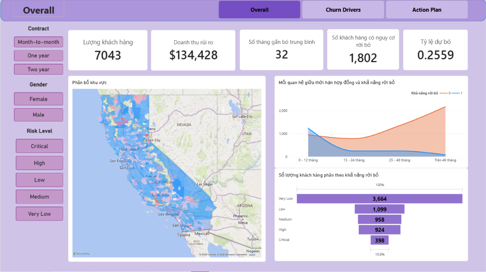
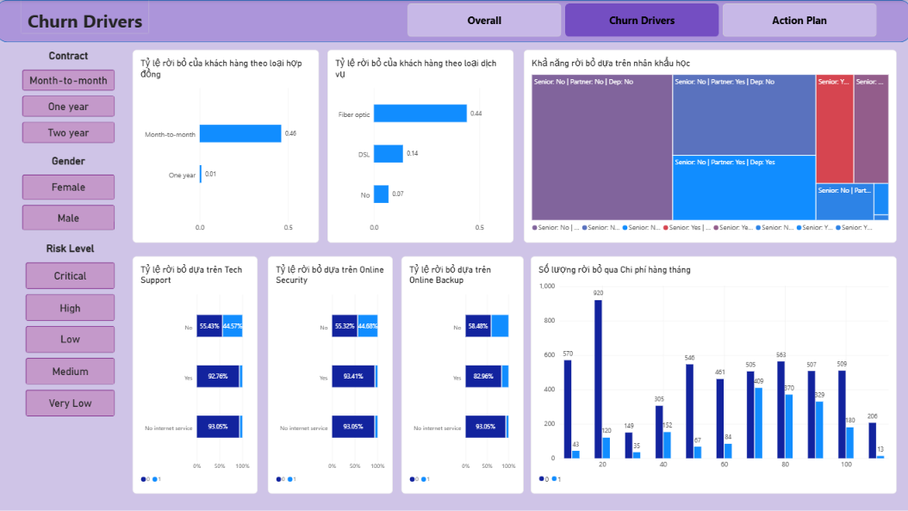
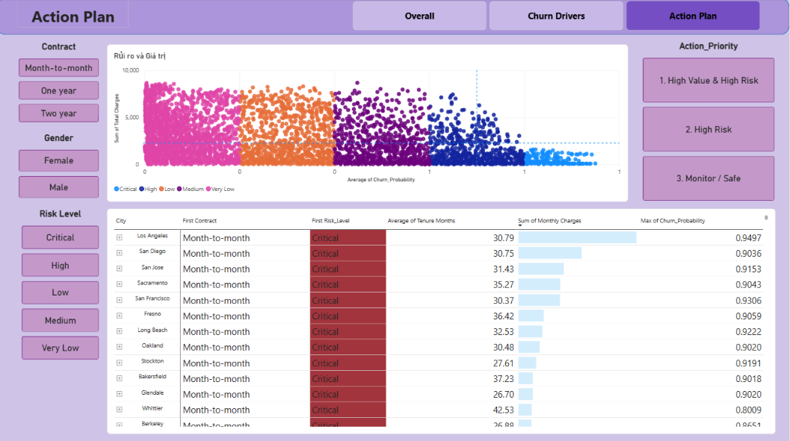
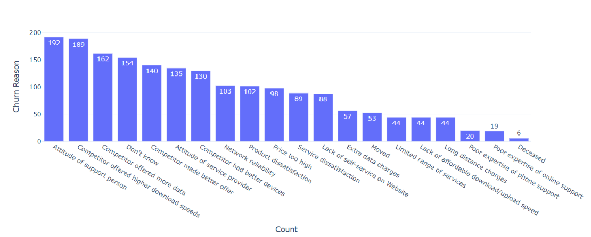
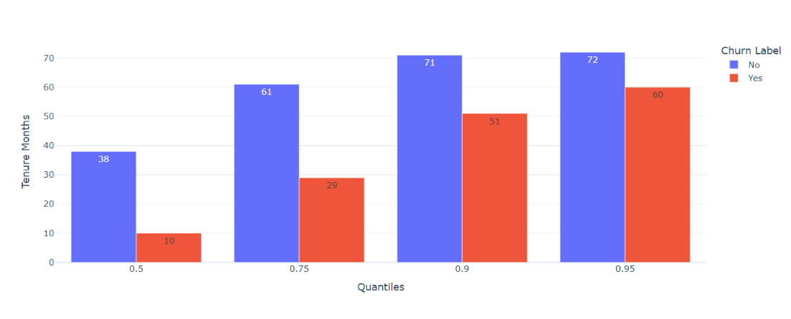
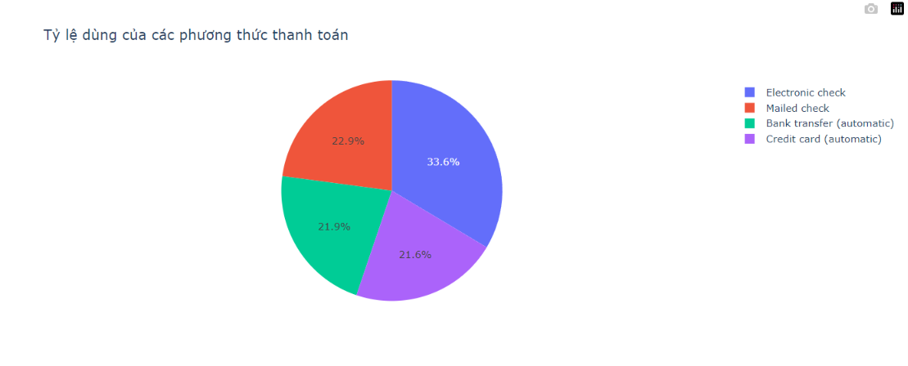
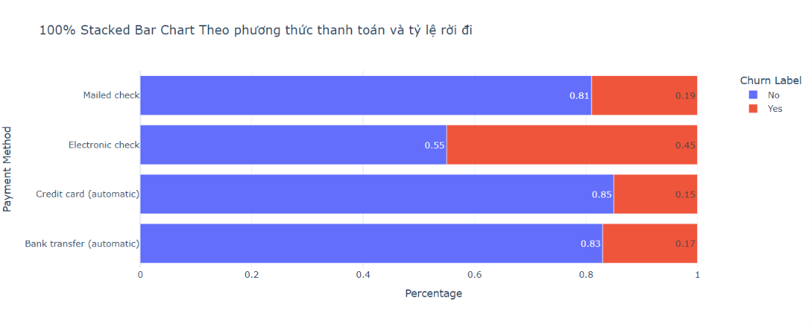

# Dự án Phân tích và Dự báo Khách hàng Rời bỏ (Telco Customer Churn)
> Một quy trình phân tích dữ liệu và hỗ trợ ra quyết định đầu-cuối (end-to-end) giúp làm sạch dữ liệu lịch sử viễn thông, khám phá chuyên sâu (EDA), huấn luyện mô hình học máy với Python (SMOTE & XGBoost) và cung cấp các phân khúc khách hàng (RFM) cùng danh sách cảnh báo sớm lên Power BI phục vụ chiến dịch giữ chân tối ưu hóa ROI.

Telco là một doanh nghiệp viễn thông, tệp dữ liếu chứa thông tin 7.043 khách hàng cá nhân tại 1.129 thành phố thuộc bang California, Hoa Kỳ. Dự án này nghiên cứu hành vi sử dụng dịch vụ, đặc điểm hợp đồng và giá trị vòng đời của khách hàng, từ đó chuyển hóa các phát hiện dữ liệu thành lộ trình can thiệp giữ chân cụ thể cho đội ngũ Chăm sóc khách hàng (CSKH) và Quản trị kinh doanh.

Mục tiêu của dự án không chỉ dừng lại ở việc chứng minh mô hình học máy có thể chạy được hay chỉ thống kê xem có bao nhiêu khách hàng đã rời bỏ. Dự án này ghi lại toàn bộ quá trình một người làm phân tích đi từ bài toán kinh doanh thực tế (doanh thu thuê bao suy giảm và khuyến mãi rải đại trà kém hiệu quả), xuyên suốt 4 cấp độ phân tích (**Mô tả -> Chẩn đoán -> Dự đoán -> Đề xuất**), đến việc xây dựng mô hình dự báo được kiểm thử chặt chẽ và thiết kế hệ thống báo cáo Power BI hỗ trợ ra quyết định. Cả những kết luận mang tính hành động lẫn các giả định tài chính và hạn chế của dữ liệu đều là một phần cốt lõi của dự án này.

## Dashboard preview

Hệ thống báo cáo Power BI được xây dựng trực tiếp từ dữ liệu đầu ra của mô hình học máy (`Results.xlsx`) kết hợp cùng các chỉ số đo lường DAX, chia làm ba trang theo luồng kể chuyện dữ liệu (**What -> Why -> What's Next**): trang tổng quan (`Overall`), trang khám phá nguyên nhân rời bỏ (`Churn Drivers`), và trang kế hoạch hành động chi tiết (`Action Plan`). Mỗi phát hiện dưới đây đều gắn liền với một câu hỏi nghiệp vụ cụ thể trong báo cáo phân tích, phản ánh dữ liệu lịch sử tại một thời điểm (snapshot Quý 3/2019).

### Overall ("What")



- **Quy mô rời bỏ và tổn thất tài chính thực tế:** Trong tổng số 7.043 khách hàng hiện hữu, có 1.869 khách hàng đã ngừng sử dụng dịch vụ (tỷ lệ Churn thực tế ở mức báo động 26,54%), làm mất đi khoảng 139.131 USD doanh thu định kỳ mỗi tháng (tương đương 1,67 triệu USD/năm) và 7.755.256 USD tổng giá trị vòng đời khách hàng (CLTV) tiềm năng.
- **Cảnh báo sớm từ mô hình dự báo trên Dashboard:** Ở trạng thái tổng thể, mô hình xác định có 1.802 khách hàng đang nằm trong diện có nguy cơ rời bỏ (tỷ lệ dự báo 25,59%), đặt 134.428 USD doanh thu hàng tháng vào vùng rủi ro (Doanh thu rủi ro / Revenue at Risk), với thời gian gắn bó trung bình của toàn tập khách hàng là 32 tháng.
- **Điểm gãy ở giai đoạn đầu vòng đời (Tenure drop-off):** Nhóm khách hàng mới (`0 - 12 tháng`) có tỷ lệ rời bỏ lên tới 47,44% (1.037/2.186 khách), sau đó giảm mạnh xuống 28,71% ở nhóm `13 - 24 tháng`, 20,39% ở nhóm `25 - 48 tháng` và chỉ còn 9,51% ở nhóm gắn bó lâu năm (`Trên 49 tháng`).
- **Phễu phân tầng mức độ rủi ro:** Toàn bộ khách hàng được phân tầng rõ rệt thành 5 mức rủi ro trên biểu đồ phễu: `Very Low` (3.664 khách), `Low` (1.099 khách), `Medium` (958 khách), `High` (924 khách) và `Critical` (398 khách — tương đương 10,9% quy mô nhóm an toàn nhất)[cite: 7].

### Churn Drivers ("Why")



- **Loại hợp đồng (Contract) là biến số có sức ảnh hưởng mạnh nhất:** Có tới 88,7% khách hàng rời bỏ đến từ nhóm hợp đồng trả theo từng tháng (`Month-to-month`). Bản thân nhóm `Month-to-month` có tỷ lệ rời bỏ thực tế lên tới 42,71%, cao gấp gần 4 lần so với hợp đồng 1 năm (11,27%) và cao gấp 15 lần so với hợp đồng 2 năm (2,83%).
- **Nghịch lý dịch vụ cáp quang (Fiber optic) và rào cản dịch vụ phụ trợ:** Mặc dù là gói cước cao cấp với tốc độ nhanh, khách hàng dùng `Fiber optic` lại có tỷ lệ rời bỏ thực tế 41,89%, cao gấp 2,2 lần so với gói `DSL` (18,96% thực tế, 14% dự báo) và bỏ xa nhóm không dùng internet (7,40% thực tế, 7% dự báo). Trên dashboard, nhóm không sử dụng `Tech Support`, `Online Security` và `Online Backup` có tỷ lệ dự báo rời bỏ lần lượt là 44,57%, 44,68% và 41,52%, trong khi nhóm có đăng ký các dịch vụ này duy trì tỷ lệ giữ chân thành công từ 82,96% đến 93,41%.
- **Đặc điểm nhân khẩu học và cấu trúc hộ gia đình:** Biểu đồ Treemap và thống kê chẩn đoán cho thấy nhóm khách hàng cao tuổi (`Senior Citizen = Yes`) có tỷ lệ rời bỏ cao gấp 1,77 lần nhóm không cao tuổi (41,68% so với 23,61%), trong khi những hộ gia đình có người phụ thuộc (`Dependents = Yes`) có tỷ lệ rời bỏ cực thấp chỉ 6,52% (thấp hơn 5 lần so với nhóm không có người phụ thuộc là 32,55%).
- **Phân phối chi phí hàng tháng (Monthly Charges):** Biểu đồ cột phân nhóm chi phí cho thấy lượng khách hàng rời bỏ tăng đột biến ở các mức cước cao từ 70 USD đến 100 USD/tháng (đỉnh điểm tại bin 70–80 USD với 409 khách dự báo rời bỏ và bin 80–90 USD với 370 khách).

### Action Plan ("What's Next")



- **Ma trận Rủi ro và Giá trị (Risk vs. Value Scatter Plot):** Biểu đồ phân tán đối chiếu xác suất rời bỏ (`Average of Churn_Probability`) trên trục X với tổng chi phí tích lũy (`Sum of Total Charges`) trên trục Y, được chia theo 5 dải màu mức độ rủi ro kèm hai đường tham chiếu đứt nét (Analytics Constant Lines). Kết hợp với cụm nút lọc nhanh `Action_Priority` bên phải (`1. High Value & High Risk`, `2. High Risk`, `3. Monitor / Safe`), đội ngũ CSKH có thể lập tức khoanh vùng góc phần tư chứa những khách hàng mang lại doanh thu lớn nhưng đang có nguy cơ hủy dịch vụ cao nhất.
- **Ma trận danh sách khách hàng cần can thiệp (Operational Matrix):** Báo cáo sử dụng cấu trúc Ma trận phân cấp theo khu vực địa lý (`City` -> `CustomerID`) đã được làm phẳng (tắt Stepped layout), tích hợp định dạng có điều kiện (tô nền đỏ cảnh báo cho mức `Critical`), thanh dữ liệu (`Data bars`) trực quan hóa quy mô `Sum of Monthly Charges`, và cột `Max of Churn_Probability` để ưu tiên xử lý các khu vực trọng điểm như Los Angeles (xác suất rời bỏ cao nhất đạt 0,9497), San Diego (0,9036), San Jose (0,9153) hay Sacramento (0,9043).

---

## Các phát hiện chuyên sâu từ Khám phá Dữ liệu (Ad hoc EDA deep-dives)

Trước khi xây dựng mô hình và đưa dữ liệu lên Power BI, quá trình phân tích khám phá (EDA) trên Python (`EDA&Model.ipynb`) và báo cáo chẩn đoán đã bóc tách những góc nhìn định lượng quan trọng mà giao diện tổng hợp của Dashboard không hiển thị hết.

### 1. Phân tích nguyên nhân trực tiếp



- **Phân tách nguyên nhân bên ngoài và bên trong:** Khảo sát trực tiếp 1.869 khách hàng đã rời bỏ cho thấy nguyên nhân chia thành hai nhóm rõ rệt: nhóm nguyên nhân bên ngoài do **đối thủ cạnh tranh** chiếm khoảng **33%** (`Competitor offered higher download speeds`: 189 khách - 10,11%; `Competitor offered more data`: 162 khách - 8,67%; `Competitor made better offer`: 140 khách - 7,49%; `Competitor had better devices`: 130 khách - 6,96%) và nhóm nguyên nhân nội tại do **thái độ phục vụ** chiếm khoảng **21%** (`Attitude of support person` dẫn đầu toàn bộ bảng xếp hạng với 192 khách - 10,27%; `Attitude of service provider`: 135 khách - 7,22%).
- **Ý nghĩa quản trị:** Khoảng 11% rời đi do chất lượng kỹ thuật (`Network reliability`: 103 khách - 5,51%; `Product dissatisfaction`: 102 khách - 5,46%) và 5,24% do giá cao (`Price too high`: 98 khách). Việc thái độ nhân viên hỗ trợ đứng vị trí số 1 khẳng định Telco hoàn toàn có dư địa can thiệp nội bộ thông qua đào tạo lại đội ngũ CSKH thay vì chỉ đổ lỗi cho áp lực cạnh tranh thị trường.

### 2.`Tenure Quantiles` 



- **Sự chênh lệch cực đại ở các mốc phân vị (Quantiles 0.50, 0.75, 0.90, 0.95):** Biểu đồ so sánh phân vị chỉ ra rằng **50%** khách hàng rời bỏ (`Churn Label = Yes`) đã chấm dứt dịch vụ chỉ trong vòng **10 tháng đầu tiên** (so với mức trung vị **38 tháng** của nhóm trung thành). Ở mốc phân vị 75%, nhóm rời bỏ có thâm niên dưới **29 tháng**, chưa bằng một nửa so với mốc **61 tháng** của nhóm ở lại.
- **Cảnh báo rủi ro ở nhóm khách hàng lâu năm:** Tại phân vị thứ 90 và 95 của nhóm rời bỏ, thời gian gắn bó vẫn vọt lên mức **51 tháng** và **60 tháng** (tương đương 4–5 năm sử dụng). Điều này cảnh báo doanh nghiệp không được chủ quan với nhóm khách hàng lâu năm trước khi họ chạm mốc ổn định hoàn toàn (71–72 tháng).

### 3. `Payment Method` x `Contract` x `Num_Services`




- **Rủi ro từ phương thức thanh toán thủ công (`Electronic check`):** Trong 4 phương thức thanh toán, `Electronic check` chiếm tỷ trọng người dùng lớn nhất (33,6%) nhưng lại có tỷ lệ rời bỏ lên tới **45,29%**, cao gấp gần 3 lần so với các phương thức thanh toán tự động có ràng buộc kỹ thuật như `Bank transfer (automatic)` (16,71%) và `Credit card (automatic)` (15,24%) hay `Mailed check` (19,11%).

---

# Nguồn gốc dữ liệu và Bối cảnh bài toán

Bộ dữ liệu sử dụng trong dự án là **Telco Customer Churn**, ghi nhận thông tin chi tiết của **7.043 khách hàng** tại bang California, Hoa Kỳ với **33 biến số**. Trong bối cảnh thị trường viễn thông Hoa Kỳ cạnh tranh gay gắt giữa các nhà mạng lớn (Verizon, AT&T, T-Mobile, Comcast) và các nhà mạng khu vực, chi phí thu hút một khách hàng mới luôn đắt đỏ hơn rất nhiều so với việc duy trì một thuê bao hiện hữu.

Doanh nghiệp đang đối mặt với 3 bài toán quản trị cốt lõi: (1) doanh thu thuê bao suy giảm qua các quý gần đây nhưng chưa rõ nguyên nhân gốc rễ, (2) lượng yêu cầu hủy dịch vụ tăng cao trong khi thiếu hệ thống cảnh báo sớm, và (3) các chiến dịch khuyến mãi đang được rải một cách đại trà, không phân biệt giữa khách hàng mang lại giá trị cao (VIP) với nhóm khách hàng ít gắn kết.

## Công nghệ sử dụng (Technology stack)

- **Ngôn ngữ & Xử lý dữ liệu:** Python, Pandas, NumPy
- **Trực quan hóa khám phá (EDA):** Plotly Express, Matplotlib, Seaborn
- **Học máy & Cân bằng dữ liệu:** Scikit-learn (`RandomForestClassifier`, `StandardScaler`, `LabelEncoder`, `RandomizedSearchCV`), XGBoost (`XGBClassifier`), Imbalanced-learn (`SMOTE`, `Pipeline`)
- **Phân tích nghiệp vụ & BI:** Power BI Desktop, DAX
- **Môi trường phát triển:** Jupyter Notebook / Google Colab

## Cấu trúc dữ liệu nguồn và Quy trình làm sạch

Bộ dữ liệu gốc (`Data.xlsx`) gồm 7.043 dòng và 33 cột, được chia thành 7 nhóm thuộc tính chính phục vụ cho các mục tiêu phân tích khác nhau[cite: 5, 18, 19]:

| Nhóm biến | Số biến | Các biến tiêu biểu | Ý nghĩa phân tích |
|---|---|---|---|
| **Định danh** | 1 | `CustomerID` | Khóa định danh duy nhất cho từng khách hàng (không có bản ghi trùng lặp) |
| **Nhân khẩu học** | 4 | `Gender`, `Senior Citizen`, `Partner`, `Dependents` | Mô tả đặc điểm cá nhân và cấu trúc hộ gia đình của thuê bao |
| **Địa lý** | 5 | `City`, `Zip Code`, `Latitude`, `Longitude`, `Lat Long` | Xác định vị trí địa lý của khách hàng trên 1.129 thành phố tại California |
| **Hợp đồng & Thanh toán** | 4 | `Tenure Months`, `Contract`, `Paperless Billing`, `Payment Method` | Phản ánh thâm niên gắn bó, mức độ cam kết hợp đồng và phương thức thanh toán |
| **Dịch vụ** | 10 | `Phone Service`, `Multiple Lines`, `Internet Service`, `Online Security`, `Online Backup`, `Device Protection`, `Tech Support`, `Streaming TV`, `Streaming Movies` | Cho biết dịch vụ viễn thông chính và 6 dịch vụ phụ trợ tạo rào cản chuyển đổi (switching cost) |
| **Tài chính** | 3 | `Monthly Charges`, `Total Charges`, `CLTV` | Thể hiện cước phí hàng tháng, tổng chi tiêu tích lũy và giá trị vòng đời khách hàng |
| **Nhãn mục tiêu & Phụ trợ** | 6 | `Churn Label`, `Churn Value`, `Churn Score`, `Churn Reason`, `Count`, `Country`, `State` | Cho biết trạng thái rời bỏ, điểm rủi ro, lý do hủy dịch vụ và các biến hằng số phụ trợ|

### Xử lý kiểu dữ liệu và điền bù giá trị thiếu (`Total Charges`)

Trong dữ liệu thô, cột `Total Charges` (Tổng chi phí) bị lưu sai dưới định dạng chuỗi/đối tượng (`object`). Sau khi ép kiểu về số thực , hệ thống phát hiện **11 bản ghi bị khuyết thiếu (`NaN`)**, chiếm tỷ lệ 0,1562%. 

Kiểm tra chéo cho thấy toàn bộ 11 khách hàng này đều có `Tenure Months = 0` (khách hàng vừa ký hợp đồng 1 năm hoặc 2 năm và chưa phát sinh kỳ hóa đơn đầu tiên) và `Churn Label = No`. Thay vì xóa bỏ làm mất thông tin khách hàng mới, giá trị thiếu được điền bù chính xác theo công thức logic nghiệp vụ:

```python
df['Total Charges'] = df['Total Charges'].fillna(df['Monthly Charges'] * df['Tenure Months'])
```

### Xử lý biến `Churn Reason` và loại bỏ các cột không có giá trị phân biệt

- **`Churn Reason` (Thiếu 5.174 dòng — 73,463%):** Tỷ lệ khuyết thiếu này hoàn toàn khớp với 73,463% khách hàng đang tiếp tục sử dụng dịch vụ (`Churn Label = No`) nên không có lý do rời bỏ. Biến này được giữ lại ở giai đoạn Phân tích Chẩn đoán để bóc tách nguyên nhân trực tiếp từ 1.869 khách hàng đã rời mạng, nhưng được loại bỏ hoàn toàn trước khi đưa vào mô hình học máy để tránh nhiễu và rò rỉ dữ liệu (data leakage).
- **Loại bỏ biến hằng số và dư thừa:** Các cột có cùng một giá trị trên toàn bộ tập dữ liệu (Low cardinality) bao gồm `Count` (`1`), `Country` (`United States`), `State` (`California`), cùng cột trùng lặp thông tin tọa độ `Lat Long` và các cột định danh có quá nhiều giá trị duy nhất (`CustomerID`, `Zip Code`) đều được loại bỏ khỏi tập đặc trưng huấn luyện.
- **Bảo toàn giá trị ngoại lai (Outliers):** Kiểm tra bằng phương pháp khoảng tứ phân vị IQR ($Q_1 - 1,5 \times \text{IQR}$ đến $Q_3 + 1,5 \times \text{IQR}$) trên các biến `Tenure Months`, `Monthly Charges`, `Total Charges` và `CLTV` cho thấy một số quan sát có giá trị tài chính rất cao. Các điểm dữ liệu này được chủ đích giữ lại vì chúng đại diện cho phân khúc khách hàng chi tiêu lớn (VIP) mà doanh nghiệp cần ưu tiên bảo vệ.

